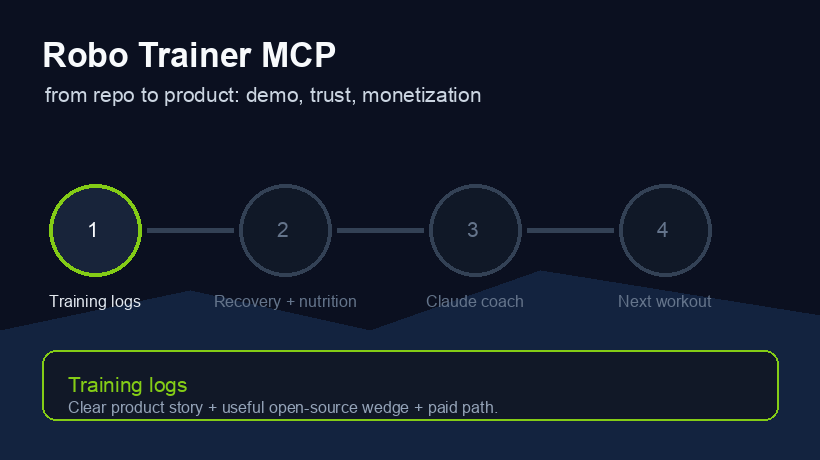

# robo-trainer-mcp


**A local training and nutrition log, calculators and plan generator for lifters and general fitness.** It keeps food, lifts, sleep, recovery and mood in one place so your AI assistant can answer "why did my squat stall?" from your own data, and it can build and adjust a rule-based program from your goals, equipment and schedule. It is for people who already use an MCP client such as Claude Desktop. Nothing leaves your machine except food search.

**Try the calculators in your browser, no install:** https://gerardrecinto.github.io/robo-trainer-mcp/

## Install in one line

Needs Python 3.12 or later.

```bash
uvx --from git+https://github.com/gerardrecinto/robo-trainer-mcp robo-trainer-mcp
```

Then add it to your MCP client (for example Claude Desktop, `~/Library/Application Support/Claude/claude_desktop_config.json`) and restart the client:

```json
{
  "mcpServers": {
    "trainer": {
      "command": "uvx",
      "args": ["--from", "git+https://github.com/gerardrecinto/robo-trainer-mcp", "robo-trainer-mcp"]
    }
  }
}
```

No uv? Use pip instead: `pip install git+https://github.com/gerardrecinto/robo-trainer-mcp`, then set `"command": "robo-trainer-mcp"`. Or use Docker: `docker run --rm -i -v robo-trainer-data:/data ghcr.io/gerardrecinto/robo-trainer-mcp:latest`. It is not on PyPI yet. Use Python 3.12 or 3.13: on 3.14 some dependencies may have no prebuilt wheel yet.

Your data lives in `~/.robo-trainer`. Set `ROBO_TRAINER_HOME` to put it somewhere else.



---

## The problem it solves

Every fitness app works in isolation. Your food tracker knows your macros. Your training log knows your lifts. Your sleep tracker knows your HRV. None of them talk to each other, and none of them can tell you why you are stuck.

robo-trainer-mcp keeps those logs together. An MCP client can pull training volume, sleep trends, nutrition and mood at once, then reason across them. The model does the reasoning and it can be wrong. The server supplies your numbers and the calculators.

---

## Examples

These conversations show what a client can do. The first uses made-up numbers to show the shape of an answer. The other two show real tool output for the inputs given.

### Diagnosing a plateau (illustrative numbers)

```
You: "My squat hasn't moved in 5 weeks and I feel exhausted. What's wrong?"

The client pulls:
  training_get_volume_trend("squat", weeks=6)
  recovery_get_sleep_trend(days=42)
  nutrition_get_weekly_macros()
  mental_get_mood_trend(days=42)

Then it can point out, for example: volume up with no deload, sleep trending
down, calories and protein under goal. Those are the usual overreaching signs.
```

### Powerlifting meet prep (real output)

```
You: "I squat 200, bench 130, deadlift 240 at 93 kg bodyweight."

  Wilks (1994): 358.1  (Advanced)
  DOTS:         362.7  (Advanced)

  Weakest lift vs typical proportions: bench, 3.2% below.

  Attempt suggestions (opener / second / third):
    Squat    180 / 195 / 202.5
    Bench    117.5 / 125 / 132.5
    Dead     215 / 232.5 / 242.5
```

### Readiness check (real output)

```
You: "I slept 6 hours, quality 5/10, soreness 7/10, stress 7/10."

  recovery_calculate_readiness(6.0, 5, 7, 7)

  Readiness: 58.5 / 100
  Recommendation: light technique session or active recovery.
```

### Plan a program (real output)

```
You: "Plan 4 weeks for me. Hypertrophy, intermediate, 3 days a week, 45 minutes,
      dumbbells, a bench and a pull-up bar."

  profile_set(goals=["hypertrophy"], experience="intermediate",
              equipment=["dumbbells", "bench", "pull_up_bar"],
              days_per_week=3, session_minutes=45)
  plan_generate(weeks=4, start_date="2026-11-09")

  Split full_body: full_a Mon, full_b Wed, full_c Fri, about 44 min each
  Week 1 (build), Mon 2026-11-09, full_a, about 44 min
    Goblet Squat: 4 x 6 reps (range 6-10), RPE 7.0
    Dumbbell Bench Press: 4 x 6 reps (range 6-10), RPE 7.0
    Inverted Row: 4 x 6 reps (range 6-10), RPE 7.0
    Dumbbell Romanian Deadlift: 4 x 6 reps (range 6-10), RPE 7.0
    Side Plank: 2 x 30 s hold (range 30-60)
  Week 4 (deload), Mon 2026-11-30, full_a, about 24 min
    Goblet Squat: 2 x 6 reps (range 6-10), RPE 5.5
    Dumbbell Bench Press: 2 x 6 reps (range 6-10), RPE 5.5
    Inverted Row: 2 x 6 reps (range 6-10), RPE 5.5
    Dumbbell Romanian Deadlift: 2 x 6 reps (range 6-10), RPE 5.5
    Side Plank: 1 x 30 s hold (range 30-60)
```

The plan also returns the rules it used, so you can check them. Weeks 2 and 3 add a rep and half an RPE point each. `plan_adjust` rebuilds the plan for low readiness, missed days, a new equipment list or a limitation, and returns a diff.

### Daily targets from your body and goal (real output)

```
You: "80 kg, 180 cm, 30, male, moderately active. I want to lose fat."

  nutrition_estimate_targets(80, 180, 30, "male", "moderate", "lose")

  Maintenance 2759 kcal. Target 2207 kcal, 160 g protein, 254 g carbs, 61 g fat.
```

---

## How the numbers are calculated

Every formula is a published one, applied to what you enter. They are estimates, not measurements, and none of this is medical advice.

| Tool area | Method | Limits |
|---|---|---|
| One-rep max | Epley and Brzycki rep formulas, plus an RPE chart estimate | Rep formulas lose accuracy above about 10 reps, and the tool warns you |
| Daily calories | Mifflin-St Jeor equation with activity multipliers 1.2 to 1.9 | Deficit capped near 20 percent, floor of 1200 kcal (women) or 1500 kcal (men) |
| Protein | 1.6 g per kg to gain or maintain, 2.0 g per kg while cutting | Based on Morton et al. 2018 and the ISSN position stand (1.4 to 2.0 g per kg) |
| Sleep | Adults need at least 7 hours (AASM and SRS consensus) | The readiness score is a hand-weighted heuristic, not a validated test |
| Powerlifting scores | DOTS, and the original 1994 Wilks formula | The 2020 Wilks revision is not included. The bands (Beginner to Elite) are rough |
| Training plans | Fixed rules: a split from days per week and goal, sessions fitted to your minutes, one extra rep and half an RPE point per build week, a deload every 4th week | A starting template from a small built-in exercise library, not a coach. The limitation filter only removes exercises tagged for that limitation. Ask a qualified professional about any injury or health condition |
| Strongman targets, lift ratios | Rough illustrative numbers | Not official standards |

Empty-database results are labelled `sample_data: true` so made-up demo values are never mistaken for yours. Bad input (negative weights, zero reps, RPE above 10) returns a clear error instead of a wrong answer.

---

## Architecture

```
                 ┌──────────────────────────────────┐
                 │        MCP client (LLM)           │
                 │   reasons across all 36 tools     │
                 └─────────────┬────────────────────┘
                               │  MCP Protocol (stdio)
                 ┌─────────────▼────────────────────┐
                 │        robo-trainer-mcp           │
                 │         (FastMCP server)          │
                 └────────┬─────────────┬────────────┘
                          │             │
             ┌────────────▼──┐  ┌─────▼─────────────────┐
             │   SQLite DB   │  │  Open Food Facts API  │
             │ ~/.robo-      │  │  (food search only)   │
             │  trainer/     │  └──────────────────────┘
             │  data.db      │
             └───────────────┘
```

All personal data stays in `~/.robo-trainer/data.db`. No account required. Every tool call is also written to a local audit log in the same folder. The log records the tool name and its parameters, so it can contain what you typed into a tool. At 5 MB it moves to `audit.log.1`, replacing the previous one, so it holds at most about 10 MB. Set `ROBO_TRAINER_AUDIT_MAX_BYTES` to change the limit.

---

## Tools: 36 total

### Nutrition
| Tool | Description |
|---|---|
| `nutrition_search_food` | Search 3M+ products via Open Food Facts |
| `nutrition_log_meal` | Log food with calories and macros |
| `nutrition_get_daily_summary` | Daily totals vs. goals |
| `nutrition_get_weekly_macros` | 7-day rolling average |
| `nutrition_estimate_targets` | Estimate calories and macros from your body, activity and goal (Mifflin-St Jeor) |
| `nutrition_set_goals` | Set calorie and macro targets |

### Strength Training
| Tool | Description |
|---|---|
| `training_log_set` | Log a set: weight, reps, RPE |
| `training_get_prs` | Personal records for every exercise |
| `training_calculate_1rm` | Epley and Brzycki estimates + full percentage chart |
| `training_estimate_1rm_from_rpe` | Estimate your 1RM from a set and its RPE |
| `training_get_volume_trend` | Weekly volume trend over N weeks |
| `training_get_session_history` | Session history for an exercise |
| `training_log_bodyweight` | Log bodyweight in kg for a date |
| `training_get_bodyweight_trend` | Bodyweight trend, net change, average over N days |
| `training_check_overreaching` | Flag overreaching risk from rising volume + rising RPE |

### Powerlifting
| Tool | Description |
|---|---|
| `pl_calculate_wilks` | Original (1994) Wilks score + rough band |
| `pl_calculate_dots` | DOTS score + rough band |
| `pl_predict_attempts` | Opener, 2nd, 3rd attempt suggestions |
| `pl_analyze_sbd_ratio` | Compare your squat, bench and deadlift shares with typical proportions |

### Strongman
| Tool | Description |
|---|---|
| `strongman_log_event` | Log: weight, reps, time, or distance |
| `strongman_get_event_prs` | Best per event |
| `strongman_get_event_history` | Progress over time |
| `strongman_competition_standards` | Compare to novice → pro benchmarks |

### Recovery
| Tool | Description |
|---|---|
| `recovery_log_sleep` | Log hours, quality, HRV |
| `recovery_get_sleep_trend` | Sleep metrics over N days |
| `recovery_calculate_readiness` | 0–100 readiness from 4 inputs |

### Planning
| Tool | Description |
|---|---|
| `profile_set` | Save goals, experience, equipment, days per week, session minutes and limitation tags |
| `profile_get` | Read the profile, or list the fields still missing |
| `exercise_search` | Search the built-in library by muscle, equipment and limitation tags to leave out |
| `plan_generate` | Build a multi-week program with sets, reps, RPE, a deload week and the rules used |
| `plan_get_today` | The planned session for a date, or a rest day |
| `plan_adjust` | Revise the plan for low readiness, missed days, an equipment change or a limitation, with a diff |
| `plan_review_progress` | Planned versus logged sets over the last N weeks, with sleep, stress and overreaching context |

Cardio and mobility sessions appear in plans, but `training_log_set` only records weight and reps, so those sessions cannot be logged and `plan_review_progress` leaves them out of its counts.

### Mental Performance
| Tool | Description |
|---|---|
| `mental_log_mood` | Log mood, energy, stress (1–10) |
| `mental_get_mood_trend` | Rolling averages over N days |
| `mental_correlate_performance` | Pearson r: energy/stress vs. training output |

---

---

## Develop and release

```bash
git clone https://github.com/gerardrecinto/robo-trainer-mcp && cd robo-trainer-mcp
python3 -m venv .venv && . .venv/bin/activate
pip install -e ".[dev]"
ruff check src tests scripts
pytest                      # unit, integration and stdio end-to-end tests
npm ci && npm test          # website tests in Chromium, Firefox and WebKit
```

The tests run the real server against a real SQLite file, and start it as a subprocess to speak MCP over stdio. A golden list pins all 36 tool names. Several tests check formulas against values worked out by hand or from a published example.

| Stage | Trigger | What runs |
|---|---|---|
| Test | every pull request | ruff, tests on Python 3.12 and 3.13 on Linux and macOS, a wheel installed into a clean virtual environment and started, the Docker image started, the website in three browsers, pip-audit |
| Merge | `CI gate` passes | the one required check. Pull requests squash-merge into `main`. Dependabot patch and minor updates merge on their own after the gate |
| Dev | merge to `main` | the `:edge` image is published and the site is deployed to GitHub Pages |
| Production | a `v*` tag matching the version in `pyproject.toml` | tests, wheel and sdist with checksums, container image with provenance and an SBOM, and a GitHub release |

A weekly canary starts the server against the newest `mcp` release, including the 2.x line this project does not support yet.

## Product direction

This can grow into a local-first AI coaching product: open-source MCP server as the wedge, Pro dashboards for athletes, and Coach Mode for trainers managing clients. See [docs/go-to-market.md](docs/go-to-market.md).

## License

MIT
